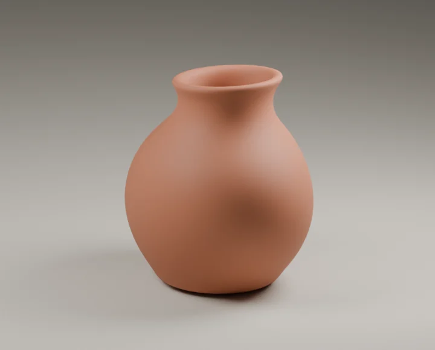
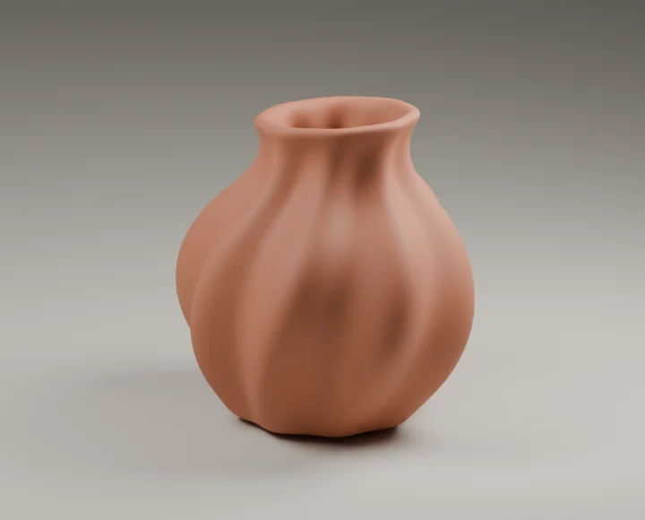

<p align="center"></p>

<h1 align="center">ReShape</h1>

<p align="center"><strong>A Blender 3D modeling skill for AI agents. Model, sculpt, and review meshes with Codex, Claude Code, Cursor, Antigravity, and other agents that support skills.</strong></p>
<p align="center">Create realistic, stylized, or low-poly assets from scratch, or refine an existing mesh. Use visual references to guide the form and check each pass.</p>
<p align="center"><a href="#install-in-codex">Install</a> · <a href="skills/reshape/references/anatomy.md">Anatomy</a> · <a href="skills/reshape-styles/SKILL.md">Styles</a> · <a href="#website">Website</a> · <a href="README.pt-BR.md" lang="pt-BR">Português (Brasil)</a></p>

| Blockout | Volumes | Surface |
| :---: | :---: | :---: |
|  |  |  |
| Establish the silhouette. | Refine the shoulder and neck. | Sculpt and check the grooves. |

*The same vase across three modeling passes, with camera and lighting held fixed.*

## Install in Codex

From the repository root, copy ReShape and its companion skills into the Codex skills directory.

```sh
mkdir -p ~/.agents/skills
cp -R skills/reshape skills/reshape-styles skills/reshape-style-* skills/reshape-anatomy-* ~/.agents/skills/
```

To edit through MCP, open Blender and connect the Blender MCP server to your agent. Invoke `$reshape` in Codex with your brief or reference.

```text
$reshape Model the vase in this image. Compare the silhouette in front and three-quarter views.
$reshape Review the shoulder transitions in this mesh and check deformation in the test poses.
```

## How it works

1. Supply a visual reference or authorize the agent to search for one. The agent asks which option you prefer when no usable image is available.
2. Model in passes. Resolve silhouette and primary masses before transitions and surface details.
3. Compare the reference and render side by side. Overlay aligned views and inspect silhouettes, landmarks, and close-ups. Hold pose, camera, scale, and lighting fixed between rounds.
4. Verify the mesh for its intended use. Check deformation for rigging, closure and thickness for printing, or cost on the target platform for real-time work.

Deliver the editable mesh, comparative views, and documented validation results. The [ReShape skill](skills/reshape/SKILL.md) explains each step.

## Anatomy and style

The [anatomy catalog](skills/reshape/references/anatomy.md) has five skills for the figure, head and neck, torso, upper limb, and lower limb. Local guides retain construction rules, views, rejection criteria, and anatomy sources. For a nose correction, invoke `$reshape-anatomy-head` and open its nose guide.

When upgrading, move obsolete `reshape-anatomy-*` folders from your skills directory to a backup outside it. Keep the five folders listed in the catalog and restart Codex to refresh the list.

Use the [local Blender audit](skills/reshape/references/validation.md#verify-mesh-and-intended-use) for topology counts from the saved candidate. Review the matching views separately to approve the shape.

Use [`$reshape-styles`](skills/reshape-styles/SKILL.md) to choose among 10 specialized modeling styles, each with visual references and approval checks. For example, use `$reshape-style-faceted-low-poly` to review faceted geometry or `$reshape-style-cel-shading` to review shadow bands and linework. The skills use US English. Invocation names are the same in both versions of the site.

## Website

The [ReShape 3D modeling skill website](https://reshape.eduardoaugusto.work/) shows three modeling passes and lets you compare the blockout and surface in front, profile, and three-quarter views. US English is the default, with Brazilian Portuguese at `/pt-br`.

```sh
cd site
bun install
bun run dev
```

## License

[MIT license](LICENSE).
