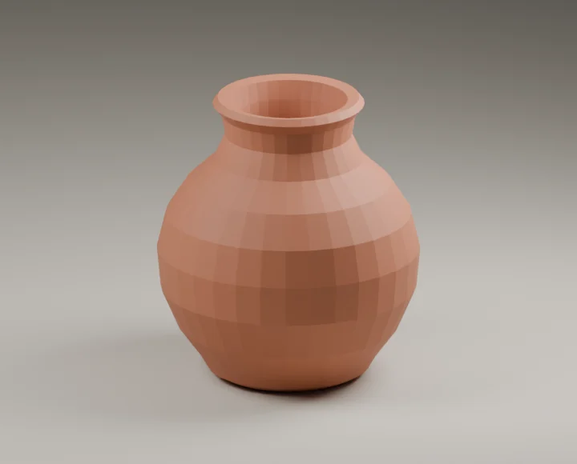

<p align="center"></p>

<h1 align="center">ReShape</h1>

<p align="center"><strong>Model, sculpt, and review 3D assets in Blender with Codex and Blender MCP.</strong></p>
<p align="center">Start from an image, a brief, or an existing mesh. Compare matching views each round to decide what to correct.</p>
<p align="center"><a href="#install-in-codex">Install</a> · <a href="skills/reshape/references/anatomia.md">Anatomy</a> · <a href="skills/reshape-estilos/SKILL.md">Styles</a> · <a href="#website">Website</a> · <a href="README.pt-BR.md" lang="pt-BR">Português (Brasil)</a></p>

| Blockout | Volumes | Surface |
| :---: | :---: | :---: |
|  |  |  |
| Establish the silhouette. | Refine the shoulder and neck. | Sculpt and check the grooves. |

*The same vase across three modeling passes, with camera and lighting held fixed.*

## Install in Codex

From the repository root, copy ReShape and its companion skills into the Codex skills directory.

```sh
mkdir -p ~/.agents/skills
cp -R skills/reshape skills/reshape-estilos skills/reshape-style-* skills/reshape-anatomia-* ~/.agents/skills/
```

To edit through MCP, open Blender and connect the Blender MCP server to your agent. Invoke `$reshape` in Codex with your brief or reference.

```text
$reshape Model the vase in this image. Compare the silhouette in front and three-quarter views.
$reshape Review the shoulder transitions in this mesh and check deformation in the test poses.
```

## How it works

1. Extract observable criteria from the brief or reference and document any inferred regions.
2. Model in passes. Resolve silhouette and primary masses before transitions and surface details.
3. Capture matching views and correct discrepancies. Hold pose, camera, scale, and lighting fixed between rounds.
4. Verify the mesh for its intended use. Check deformation for rigging, closure and thickness for printing, or cost on the target platform for real-time work.

Deliver the editable mesh, comparative views, and documented validation results. The [ReShape skill](skills/reshape/SKILL.md) explains each step.

## Anatomy and style

The [anatomy catalog](skills/reshape/references/anatomia.md) includes 44 skills, from the whole body to individual features and joints. Each skill gives construction rules, inspection views, rejection criteria, and anatomy sources. Use `$reshape-anatomia-face` to integrate facial features or `$reshape-anatomia-nariz` to review a nose.

Use [`$reshape-estilos`](skills/reshape-estilos/SKILL.md) to choose among 10 specialized modeling styles, each with visual references and approval checks. For example, use `$reshape-style-faceted-low-poly` to review faceted geometry or `$reshape-style-cel-shading` to review shadow bands and linework. The skills use US English. Invocation names are the same in both versions of the site.

## Website

The [ReShape site](site/README.md) shows three modeling passes and lets you compare the blockout and surface in front, profile, and three-quarter views. US English is the default, with Brazilian Portuguese at `/pt-br/`.

```sh
cd site
bun install
bun run dev
```

## Credits

ReShape adapts the capture, comparison, and revision workflow of [Reanimate by Niaz Morshed](https://github.com/NiazMorshed2007/reanimate). The original skill is in [skills/reanimate](skills/reanimate). [MIT license](LICENSE).
