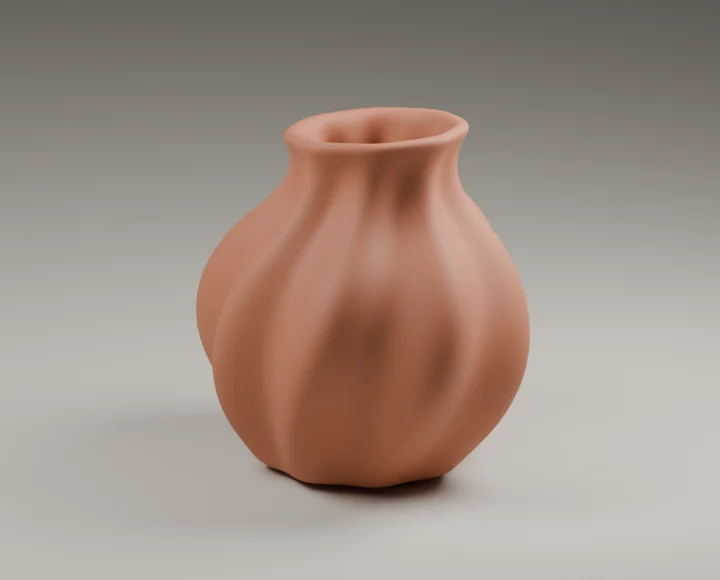

# ReShape

[English](README.md)
ReShape é uma skill para modelar, esculpir e revisar ativos 3D no Blender. Ela trabalha a partir de imagens, texto ou de uma malha existente e usa o Blender MCP quando disponível.



As instruções das skills estão em inglês dos EUA. O site oferece português e inglês.

## Instalação no Codex

Na raiz do repositório, copie a pasta da skill para o diretório de skills do Codex.

```sh
mkdir -p ~/.agents/skills
cp -R skills/reshape skills/reshape-estilos skills/reshape-anatomia-* ~/.agents/skills/
```

Para editar pelo MCP, abra o Blender e conecte o servidor Blender MCP ao agente. No Codex, invoque `$reshape` com o briefing ou a referência.

```text
$reshape Modele o vaso desta imagem no Blender. Compare a silhueta de frente e em três quartos.
$reshape Revise as transições dos ombros nesta malha e confira a deformação nas poses de teste.
```

## Como funciona

1. Extraia critérios observáveis da referência ou do briefing. Registre o que pode ser conferido e o que precisou ser inferido.
2. Modele em passagens. Resolva primeiro a silhueta e as massas principais, depois as transições e os detalhes da superfície.
3. Capture vistas comparáveis e corrija os desvios. Mantenha pose, câmera, escala e luz fixas entre rodadas.
4. Verifique a malha conforme o destino. Para rig, confira a deformação. Para impressão, confira fechamento e espessura. Para tempo real, confira o custo no destino.

A entrega inclui a malha editável, as vistas comparativas e o estado da validação. O [guia da skill](skills/reshape/SKILL.md) detalha cada etapa.

## Anatomia humana

O [catálogo de anatomia](skills/reshape/references/anatomia.md) reúne skills por região, desde corpo inteiro até olhos, orelha, nariz, mãos e pés. Cada skill traz regras de construção, vistas de revisão, motivos de reprovação e fontes anatômicas. Use `$reshape-anatomia-face` para uma face inteira ou `$reshape-anatomia-nariz` para uma revisão localizada.

## Estilos de modelagem

Use [`$reshape-estilos`](skills/reshape-estilos/SKILL.md) para definir regras de silhueta, geometria e acabamento em estilos como realista, low-poly, cartoon, chibi e cel shading.

## Site

O [site da ReShape](site/README.pt-BR.md) demonstra três passagens de modelagem de um vaso e permite comparar bloqueio e superfície em frente, perfil e três quartos.

```sh
cd site
bun install
bun run dev
```

## Créditos

O ciclo de captura, comparação e revisão foi adaptado da [Reanimate de Niaz Morshed](https://github.com/NiazMorshed2007/reanimate). O código original da skill está em [skills/reanimate](skills/reanimate). [Licença MIT](LICENSE).
